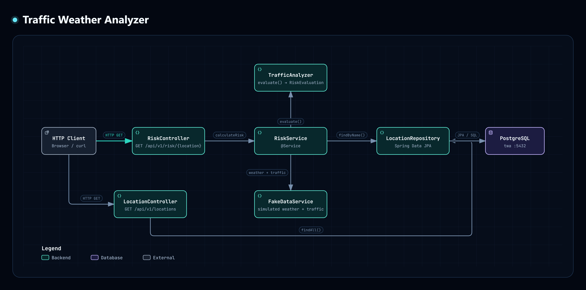

# Traffic & Weather Bottleneck Analyzer (Backend)

[](https://github.com/Vikramkhajuria/traffic-weather-analyzer-java/actions/workflows/build.yml)

A containerized Spring Boot backend that analyzes traffic congestion risk based on location data, weather conditions, and traffic signals.
Built to practice real-world backend engineering workflows, not just coursework.

## What this project is

This project simulates how a backend service:
- exposes REST APIs
- persists domain data in a relational database
- applies business logic to compute risk levels
- runs consistently across environments using Docker

The goal was to move beyond "works on my machine" and build something that resembles how production backends are actually developed and run.

## Architecture Overview



All services run inside Docker containers, ensuring consistent behavior across machines.

## Tech Stack

**Backend**
- Java 17
- Spring Boot 3
- Spring Web
- Spring Data JPA
- Hibernate

**Database**
- PostgreSQL

**Infrastructure**
- Docker
- Docker Compose
- Gradle

## Features Implemented

- Location entities persisted in PostgreSQL, seeded automatically on startup
- Risk calculation based on traffic congestion level and weather conditions
- Scored risk evaluation with detailed reasoning per location
- REST endpoints:
  - `GET /api/v1/locations` — list all locations
  - `GET /api/v1/risk/{location}` — get risk analysis for a location
- Structured error responses with HTTP status codes
- API documentation via OpenAPI / Swagger UI at `/swagger-ui.html`
- Application runs fully containerized (API + DB)

## REST API

### List all locations

```
GET /api/v1/locations
```

### Get risk analysis for a location

```
GET /api/v1/risk/{location}
```

**Seeded locations** (available out of the box):

| Location name | Example curl |
|---|---|
| Stockholm Central | `curl "http://localhost:8080/api/v1/risk/Stockholm%20Central"` |
| Malmö Center | `curl "http://localhost:8080/api/v1/risk/Malm%C3%B6%20Center"` |
| E4 Northbound | `curl "http://localhost:8080/api/v1/risk/E4%20Northbound"` |
| Gothenburg Ring Road | `curl "http://localhost:8080/api/v1/risk/Gothenburg%20Ring%20Road"` |

**Example response:**

```json
{
  "location": "Stockholm Central",
  "temperature": 0,
  "condition": "Snow",
  "congestion": 9,
  "riskLevel": "HIGH",
  "score": 95,
  "reasons": ["Congestion >=8", "Snow conditions", "Temperature <= 0°C with snow"]
}
```

The API returns a 404 with a structured error body for unknown location names.

### Swagger UI

Interactive API docs are available at:

```
http://localhost:8080/swagger-ui.html
```

## Core Concepts Practiced

- REST API design with Spring Boot
- Layered backend architecture (Controller → Service → Repository)
- JPA / Hibernate with PostgreSQL
- Domain-driven risk evaluation logic
- Database schema management
- Environment-agnostic execution using Docker & Docker Compose

## Running the project

```bash
docker compose up --build
```

The API will be available at `http://localhost:8080`.

## Database credentials

The default credentials (`username: twa`, `password: twa`) are for local development only.
For any real deployment, override them via environment variables:

```
SPRING_DATASOURCE_USERNAME=...
SPRING_DATASOURCE_PASSWORD=...
```

The `docker-compose.yml` already passes these through from the environment to the containers.

## Tests

There is a minimal unit test suite covering `TrafficAnalyzer.evaluate()`: LOW, MEDIUM, and HIGH risk cases, storm conditions, and the score-cap invariant.
Integration and controller tests are not yet written.

Run tests with:

```bash
./gradlew test
```

## Why Docker is used here

Docker ensures:
- consistent Java version (Java 17)
- consistent database setup
- no local environment dependency issues
- easy onboarding for anyone cloning the repo

This mirrors how backend services are typically run in professional environments.

## Future work

- Replace mock data with live OpenWeatherMap API integration
- Add integration and controller tests
- Cloud deployment (Azure or similar)
- Frontend / UI

## Author

BSc Software Development (started Sep 2025)
Focused on backend engineering, systems thinking, and real-world development practices.

---

This project is intentionally backend-focused.
No UI, no distractions — just core engineering fundamentals done properly.
